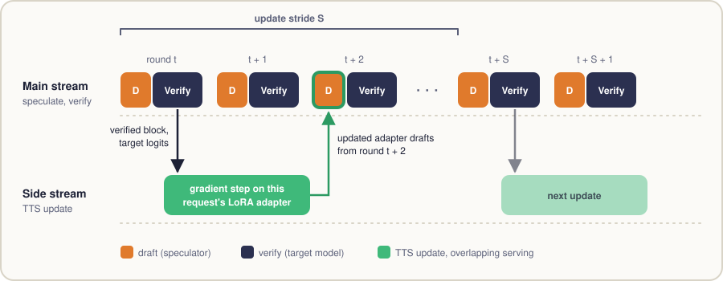

<p align="center">
  
</p>

<h1 align="center">Test-Time Speculation (TTS)</h1>

<p align="center">
  <b>Avinash Kumar</b> · <b>Sujay Sanghavi</b> · <b>Poulami Das</b><br>
  The University of Texas at Austin
</p>

<p align="center">
  <a href="https://arxiv.org/abs/2605.09329"></a>
  <a href="https://arxiv.org/abs/2605.09329"></a>
  <a href="https://avinkumarut.github.io/TTS/"></a>
  <a href="LICENSE"></a>
  <a href="README_SGLANG.md"></a>
</p>

Speculative decoding speeds up an LLM by letting a small speculator draft
tokens that the target model then verifies in one pass. The speedup depends
on how many drafted tokens are accepted per round, and that number falls as a
response gets longer: speculators are trained offline on short sequences and
drift away from the target on long reasoning, coding and agentic outputs.

**TTS adapts the speculator while the response is being generated.** Every
verification pass already produces the target's distribution at each drafted
position, which is exactly the supervision a distillation step needs. TTS
keeps that signal and uses it to update the speculator online. It needs no
extra data and no extra target calls, and as with any speculative decoding the
target model still decides every output token.

This repository is the serving implementation of TTS, built on
[SGLang](https://github.com/sgl-project/sglang) v0.5.12. It supports two
speculators, **EAGLE-3** and **DFlash**, each in two modes: per-request LoRA
adapters for batched serving, and full-weight updates for a single request.

## How it works

<p align="center">
  
</p>

- **Online distillation.** After a verify round, the speculator takes a
  gradient step toward the target's distributions on the drafted positions.
- **Strided, asynchronous updates.** A request is updated once every `S`
  rounds (the update stride), so most rounds are ordinary speculative
  decoding. The update itself is taken off the critical path:
  - *DFlash* (pictured): the whole update (forward replay of the verified
    block, backward, optimizer step) runs on a side CUDA stream while the
    next round is served. With delayed publication the new adapter is used
    for drafting two rounds later, so the next round does not wait for it.
  - *EAGLE-3*: on an update round the draft rollout itself runs with
    gradients enabled, and the optimizer step runs on a side stream and
    completes before the next draft.
- **Per-request LoRA adapters.** In a batch, one request's update must not
  change another request's speculator. The shared speculator weights stay
  frozen and every in-flight request gets its own rank-16 LoRA adapter slot.
  On the Qwen3.5-122B-A10B speculator at four GPUs, an adapter and its optimizer
  state cost 28.6 MB per request on each rank, against roughly 2,445 MB for a
  private copy of the trainable weights and their optimizer state.
- **Full-weight updates.** With one request at a time, TTS can update the
  speculator's own weights instead, and restores them when the next request
  starts. The optimizer state is FP32 by default while the served weights stay
  BF16, and the speculator's CUDA graph stays on; only an update round drafts
  outside it, because a graph replay cannot record gradients.

## Quick start

Install from source (Python 3.10+, CUDA GPUs):

```bash
git clone https://github.com/avinkumarUT/test-time-speculation.git
cd test-time-speculation
pip install -e "python[all]"
```

[`examples/tts`](examples/tts) has launch scripts with the full server command
line:

| Script | Target model | Speculator | GPUs |
|---|---|---|---|
| [`launch_dflash_qwen3.6-27b.sh`](examples/tts/launch_dflash_qwen3.6-27b.sh) | `Qwen/Qwen3.6-27B` | DFlash (`z-lab/Qwen3.6-27B-DFlash`) | 4 |
| [`launch_dflash_qwen3.5-122b.sh`](examples/tts/launch_dflash_qwen3.5-122b.sh) | `Qwen/Qwen3.5-122B-A10B` | DFlash (`z-lab/Qwen3.5-122B-A10B-DFlash`) | 8 (recommended) |
| [`launch_eagle3_qwen3-8b.sh`](examples/tts/launch_eagle3_qwen3-8b.sh) | `Qwen/Qwen3-8B` | EAGLE-3 (`AngelSlim/Qwen3-8B_eagle3`), full-weight | 1 |

```bash
# Serve with TTS (per-request LoRA adapters)
bash examples/tts/launch_dflash_qwen3.6-27b.sh

# Choose the batch size and port
BS=32 PORT=30000 bash examples/tts/launch_dflash_qwen3.6-27b.sh

# Full-weight TTS, one request at a time
TTS=full bash examples/tts/launch_dflash_qwen3.6-27b.sh

# Frozen speculator, for comparison
TTS=0 bash examples/tts/launch_dflash_qwen3.6-27b.sh
```

`BS` is the number of concurrent requests. The server speaks the usual SGLang
and OpenAI-compatible APIs; nothing changes on the client side.

The main TTS options:

| Option | Meaning |
|---|---|
| `--speculative-eagle-tts-enable`, `--speculative-dflash-lora-tts-enable` | Turn TTS on for the EAGLE-3 or DFlash speculator. |
| `--speculative-eagle-tts-mode full`, `--speculative-dflash-tts-enable` | Full-weight TTS for one request at a time. The other `--speculative-dflash-tts-*` options configure it. |
| `--speculative-eagle-tts-optimizer-dtype`, `--speculative-dflash-tts-optimizer-dtype` | `float32` (default) keeps an FP32 master copy and FP32 Adam moments, so small updates accumulate. `bfloat16` keeps the state in BF16, which halves its memory but rounds away very small updates. |
| `--speculative-tts-loss` | Online loss, for every speculator and mode. `lk` (default) is the negative log of the acceptance probability, `-log(sum_x min(p(x), q(x)))`. `kl` is `lambda * KL(target \|\| draft) + (1 - lambda) * self-CE`, with `--speculative-tts-lambda`. |
| `--speculative-eagle-tts-freq`, `--speculative-dflash-lora-tts-freq` | Update stride `S`: a request is updated once every `S` rounds. A cheap speculator (single-layer EAGLE-3) favors a small stride; a heavier one (multi-layer DFlash) favors a larger stride. |
| `--speculative-dflash-lora-tts-delayed-publish` | DFlash: adapters trained in round `N` are used for drafting from round `N+2` instead of `N+1`. The update then has a full round to finish on the side stream, so the next round does not wait for it. Recommended for throughput. |
| `--speculative-eagle-tts-mode lora`, `--speculative-eagle-tts-per-request` | EAGLE-3: update low-rank adapters with the base weights frozen, with one adapter slot per in-flight request. Required for batched serving. |
| `--speculative-eagle-tts-lora-rank`, `--speculative-dflash-lora-tts-rank` | LoRA rank (default 16). |
| `--speculative-eagle-tts-lora-targets`, `--speculative-dflash-lora-tts-targets` | Which projections carry adapters. |
| `--speculative-eagle-tts-lr`, `--speculative-dflash-lora-tts-lr` | Learning rate of the online update. |
| `--max-running-requests` | Batch size; also the number of adapter slots. |

`python -m sglang.launch_server --help` lists every option.

## Reproducing the batched-serving results

[`experiments/tts`](experiments/tts) has the benchmark harness for batched
serving with per-request LoRA adapters on the two Qwen models with DFlash:
the launch recipes, the raw results, and a table builder.

```bash
# Rebuild the paper's tables (no GPU needed)
python experiments/tts/make_tables.py
```

See [`experiments/tts/README.md`](experiments/tts/README.md) for the full
protocol and for how to rerun the experiments.

**Scope.** The experiments shipped here are the batched-serving results with
per-request LoRA adapters on Qwen3.6-27B and Qwen3.5-122B-A10B with DFlash.
The paper's single-request studies across other speculators and models,
including PARD, were run with separate research code.

## Acceptance length against output length

Acceptance length falls as a response gets longer, so its curve over the output
is what shows TTS working. To dump it, start the server with
`--speculative-accept-log-dir` and a fresh directory (DFlash, and EAGLE-3 with
top-k 1; with or without TTS). The launch scripts pass extra arguments through:

```bash
bash examples/tts/launch_dflash_qwen3.6-27b.sh --speculative-accept-log-dir al_logs
```

Send your requests as usual, then pool the requests into bins of output length:

```bash
python examples/tts/accept_length_curve.py al_logs --bin-size 2000
```

Each request gets a file `al_logs/<rid>.txt` with one line per verify round:
that round's number of correct drafts, without the bonus token. A round's tokens
are that number plus one, so acceptance length over any stretch of the output is
tokens divided by rounds. A request sets its own file name with the `rid` field
of `/generate`; give your requests a common prefix and pass `--prefix` to leave
out the server's warm-up request. On EAGLE-3, each file ends with one extra round
whose tokens are discarded, because of the overlap schedule. For a comparison,
log the same prompts with a frozen speculator (`TTS=0`). The log adds a host
synchronization and file I/O to the scheduler loop, so measure throughput without
it.

## Adding TTS to another speculator

TTS asks little of a speculator's worker. `speculative/eagle_tts.py` and
`speculative/dflash_lora_tts.py` are worked examples.

1. **Serve the speculator.** If SGLang does not have it yet, register a worker
   with `SpeculativeAlgorithm.register` (`speculative/spec_info.py`).
2. **Keep the targets.** On an update round, copy the target's verify logits
   before verification modifies them, and pair each row with the draft
   distribution for the same token position. This off-by-one is the easiest
   thing to get wrong.
3. **Get draft logits with gradients.** A CUDA graph replay cannot record them,
   so keep the graphs for ordinary rounds and use one of two patterns on update
   rounds: run the rollout itself under autograd (EAGLE-3, `tts_grad_mode`), or
   replay the block afterwards on a side stream (per-request DFlash,
   `capture_for_replay`).
4. **Choose what trains.** Update the speculator's own weights for one request
   at a time, restoring them for the next request, or give each in-flight
   request its own LoRA adapters for batched serving. Avoid adapting the `k` and
   `v` projections of a draft with a KV cache, because entries already cached
   would no longer match the adapted weights.
5. **Take the step.** Use the shared `lk` loss (`speculative/tts_loss.py`) and
   run Adam on a side CUDA stream. If the next round's draft reads the weights
   being written, wait for the step first. Reuse `--speculative-tts-loss`; add
   flags only for what is specific to the new speculator.
6. **Test it.** Check the loss against an independent computation, and the
   gradients against a single GPU under tensor parallelism
   (`test/registered/spec/dflash_tts/test_dflash_tts_tp.py`). Then compare the
   acceptance-length curve with a frozen speculator on long responses.

## A note on non-determinism

Outputs are not bit-reproducible. Because of floating-point non-determinism, a
near-tie between two tokens can resolve differently from one run to the next,
and a long response then diverges. The same prompt can therefore produce
different text across runs, with or without TTS, so results should be compared
in aggregate (throughput, acceptance length) rather than token by token. This
is a known property of LLM inference [1, 2], and of speculative decoding in
particular, which is lossless only up to floating-point effects [3].

1. Yuan et al., [Understanding and Mitigating Numerical Sources of Nondeterminism in LLM Inference](https://arxiv.org/abs/2506.09501), 2025.
2. Atil et al., [Non-Determinism of "Deterministic" LLM Settings](https://arxiv.org/abs/2408.04667), 2024.
3. Li et al., [SpecPilot: Autonomous Algorithm Discovery and Systems Optimization for Speculative Decoding](https://arxiv.org/abs/2611.02501), 2026 (Section 2.1).

## Where the code lives

TTS is implemented inside SGLang's speculative decoding stack, under
[`python/sglang/srt`](python/sglang/srt):

| File | Contents |
|---|---|
| `speculative/eagle_tts.py` | EAGLE-3: online update state, loss, optimizer step, asynchronous stepping. |
| `speculative/eagle_lora_tts.py` | EAGLE-3: LoRA adapters, the per-request adapter pool and its optimizer. |
| `speculative/eagle_worker_v2.py` | EAGLE-3 worker, with the hooks that capture verified rounds. |
| `speculative/dflash_lora_tts.py` | DFlash: per-request adapter pool, replay of verified rounds, loss, updates, delayed publication. |
| `speculative/dflash_tts.py` | DFlash: full-weight mode, with its differentiable block forward. |
| `speculative/tts_loss.py` | The `lk` loss, shared by every mode. |
| `speculative/accept_log.py` | The per-request acceptance log. |
| `speculative/dflash_worker.py`, `models/dflash.py` | DFlash worker and draft model, serving through the adapter pool. |
| `server_args.py` | The `--speculative-tts-*`, `--speculative-eagle-tts-*`, `--speculative-dflash-tts-*` and `--speculative-dflash-lora-tts-*` options. |

Design notes: [`EAGLE3_PER_REQUEST_LORA_DESIGN.md`](python/sglang/srt/speculative/EAGLE3_PER_REQUEST_LORA_DESIGN.md),
[`DFLASH_LORA_TTS_DESIGN.md`](python/sglang/srt/speculative/DFLASH_LORA_TTS_DESIGN.md)
and [`DFLASH_TTS_DESIGN.md`](python/sglang/srt/speculative/DFLASH_TTS_DESIGN.md).
Unit tests: [`test/registered/spec/eagle_tts`](test/registered/spec/eagle_tts) and
[`test/registered/spec/dflash_tts`](test/registered/spec/dflash_tts).

## Citation

```bibtex
@inproceedings{kumar2026test,
  title     = {Test-Time Speculation},
  author    = {Kumar, Avinash and Sanghavi, Sujay and Das, Poulami},
  booktitle = {Advances in Neural Information Processing Systems},
  year      = {2026}
}
```

## Acknowledgements and license

This is a modified copy of [SGLang](https://github.com/sgl-project/sglang)
v0.5.12 (`release/v0.5.12`); the original project README is kept as
[`README_SGLANG.md`](README_SGLANG.md). It is not an official SGLang release.
All changes relative to SGLang are in this repository's commit history. We
thank the SGLang team, and the authors of EAGLE-3 and DFlash for their
speculators.

Released under the [Apache License 2.0](LICENSE), the same license as SGLang.
